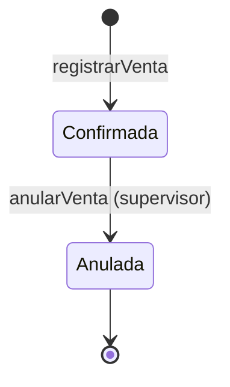
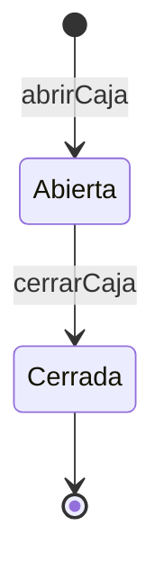

# Modelo de dominio

## Entidades

**Producto**: `id`, `nombre`, `precioCentavos`, `stock`. Es inmutable: descontar o restituir stock devuelve un producto nuevo.

**Caja**: `id`, `cajeroId`, `montoInicialCentavos`, `estado` y `movimientos`. Cada movimiento tiene un `tipo`:

- `apertura`: monto inicial en efectivo.
- `pago`: un pago de una venta, con `ventaId` y `medio`.
- `anulacion`: la reversa de un pago de una venta anulada, con `ventaId` y `medio`.

**Venta**: `id`, `cajaId`, `cajeroId`, `items`, `pagos`, `descuentoCentavos`, `totalCentavos` y `fecha`. Es inmutable: una vez registrada no se edita ni se borra.

**Anulación**: `id`, `ventaId`, `supervisorId`, `motivo` y `fecha`. Vive en su propio registro y apunta a la venta. Se guarda una como máximo por venta.

## Invariantes

1. **La venta es inmutable.** Corregir una venta se hace con una anulación, nunca editándola.
2. **Una venta se anula como máximo una vez.** El repositorio de anulaciones está indexado por `ventaId`, y la operación toma el bloqueo `venta:<id>` (ver ADR 0001).
3. **El motivo es obligatorio.** Tiene que tener texto no vacío y como máximo 255 caracteres.
4. **Solo un supervisor anula.** La verificación está en el dominio (`exigirSupervisor`), no en el frontend.
5. **El stock vuelve una sola vez.** Cada ítem de la venta suma su cantidad al stock de su producto.
6. **Solo se anula con la caja abierta.** Si la caja de la venta está cerrada, la anulación se rechaza (ver ADR 0002).
7. **El efectivo esperado de una caja** es `montoInicial + pagos en efectivo − anulaciones en efectivo`. Los pagos con tarjeta o transferencia se registran, pero no afectan el efectivo.
8. **Si una escritura falla, no queda nada a medias.** La operación valida todo antes de escribir, y si una escritura falla, vuelve a guardar el estado anterior de lo ya escrito.

## Estados

Una venta está **confirmada** mientras no tenga anulación. Una venta está **anulada** cuando existe su registro de anulación. El estado sale de los registros y no de un campo que se sobrescribe.

## Casos fuera del alcance actual

- **Devoluciones parciales.** No existen en el sistema. La anulación siempre es total.
- **Acceso por recurso para supervisores.** Un supervisor puede anular cualquier venta. Un cajero solo puede ver sus propias ventas.
- **Base de datos.** Hoy todo está en memoria. Con PostgreSQL, la operación de anulación tiene que correr en una transacción con `SELECT ... FOR UPDATE` sobre la venta, la caja y los productos.
